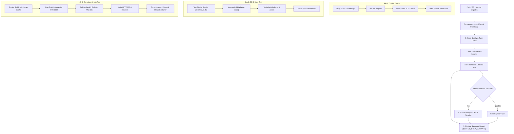

# PANTAU MBG — Sistem Pengendalian Kas & Progres Fisik Proyek SPPG

Sistem akuntansi, pemantauan kas multi-rekening (*cash pooling*), dan pengendalian progres fisik real-time untuk **27 Titik Proyek Sentra Pelayanan Program Gizi (SPPG / Makan Bergizi Gratis - MBG) Jawa Timur**.

Sistem ini mentransformasikan lembar kerja spreadsheet manual (**31 sheet file Excel** `KAS PROYEK AK BSI 12102026.xlsx`) menjadi aplikasi terpusat *server-authoritative* berbasis web yang aman, akurat hingga digit desimal rupiah terkecil, dan terlindungi *Role-Based Access Control* (RBAC).

---

## 📑 Daftar Isi
- [Latar Belakang & Transformasi Excel](#-latar-belakang--transformasi-excel)
- [Fitur Utama Sistem](#-fitur-utama-sistem)
- [Matriks Hak Akses (RBAC)](#-matriks-hak-akses-rbac)
- [Kredensial Default Pengujian](#-kredensial-default-pengujian)
- [Tech Stack](#-tech-stack)
- [Panduan Menjalankan Lokal](#-panduan-menjalankan-lokal)
- [Panduan Deployment dengan Docker](#-panduan-deployment-dengan-docker)
- [Arsitektur CI/CD Pipeline](#-arsitektur-cicd-pipeline)
- [Struktur Direktori](#-struktur-direktori)

---

## 📊 Latar Belakang & Transformasi Excel

Sebelum sistem ini dibangun, seluruh pembukuan 27 titik proyek dicatat manual pada buku besar Excel 31 sheet. Sistem web ini memetakan seluruh sheet tersebut secara presisi:

| Komponen Sumber Excel | Jumlah Data | Total Nilai Riil | Status di Web |
| :--- | :---: | :---: | :--- |
| **27 Sheet Proyek Individu** | 27 Proyek | **Rp 4.183.455.724,03** | Terpetakan pada Dashboard & Detail Proyek (`/proyek/[id]`) |
| **Pencairan Termin Klien** | 52 Transaksi | **Rp 2.175.711.864,00** | Terverifikasi masuk ke Kas Besar & Holding BSI |
| **Realisasi Pembayaran Subkon** | 99 Transaksi | **Rp 1.465.470.388,00** | Masuk ke Modul Beban Subkon & Mandor (`/subkon`) |
| **Sheet `CIH` (Cash in Hand)** | 207 Transaksi | **Saldo Rp 3.119.442,00** | Modul Kas Operasional Lapangan (`/kas-lapangan`) |
| **Sheet `TF AZKA` (Cash Pooling)** | 25 Transaksi | **Saldo Rp 42.000.000,00** | Modul Cash Pooling Pimpinan (`/cash-pooling`) |
| **Sheet `KAS BESAR PROYEK` (BSI)** | 5 Transaksi Biaya Kantor | **Saldo Rp 510.734.376,00** | Rekening Induk Operasional BSI (`12102026`) |

---

## 🚀 Fitur Utama Sistem

1. **Dashboard Eksekutif Kas Besar (`/`)**
   - 4 Metrik Keuangan Utama: *Omset Termin Masuk*, *Total Pengeluaran Kasbon/Subkon*, *Margin Kotor*, dan *Margin Bersih Riil*.
   - Filter Cepat (Hari Ini, 7 Hari, Bulan Ini, Tahun 2026, Semua Periode).
   - Multi-Row Selection & Ekspor Excel berformula dengan format rupiah rapi.
   - Pencarian cepat titik proyek berdasarkan nama dan kode SPK.
2. **Cash Pooling & Mutasi Rekening (`/cash-pooling`)**
   - Integrasi 3 pool rekening: **BSI Holding**, **Rekening Pooling Azka**, dan **Kas Kecil CIH Proyek**.
   - Pencatatan Pemasukan, Pengeluaran, dan Perpindahan Antar-Kas (*Transfer Kas*).
   - Ekspor bukti mutasi dan cetak voucher PDF otomatis.
3. **Kas Operasional Lapangan / CIH (`/kas-lapangan`)**
   - Pencatatan harian belanja semen, pasir, sewa molen, konsumsi tukang, dan kasbon harian.
   - Upload dan pratinjau bukti nota belanja fisik.
4. **Beban & Pembayaran Subkon (`/subkon`)**
   - Pemantauan RAP (Rencana Anggaran Pelaksanaan) vs Realisasi kasbon per mandor.
   - Peringatan dini (*early warning*) apabila pembayaran kasbon melebihi progres fisik.
5. **Generator Invoice & Kuitansi (`/invoice`)**
   - Penerbitan surat tagihan termin ke dinas/pemilik proyek dengan nomor otomatis dan perhitungan PPN/PPh terintegrasi.
6. **Master Data & Manajemen Pengguna (`/pengaturan`)**
   - **User Management**: Tambah pengguna, tentukan role, aktifkan/bekukan akun, dan hapus akun.
   - **Master Subkon/Mandor**: Direktori 16 rekanan vendor pelaksana, nomor rekening, dan keahlian.
   - **Master Rekening Kas**: Pengelolaan nomor rekening bank holding dan kas kecil.
7. **Health Check Endpoint (`/api/health`)**
   - Endpoint publik status container dan integritas koneksi SQLite database untuk Docker dan Kubernetes probes.

---

## 🔐 Matriks Hak Akses (RBAC)

Aplikasi menerapkan kontrol wewenang berbasis peran (*Role-Based Access Control*) dengan proteksi server-side guard (`hooks.server.ts`), filtrasi navigasi dinamis, dan *field-level masking*:

| Fitur / Halaman | `DIREKTUR` (Pimpinan) | `FINANCE` (Keuangan HO) | `SITE_MANAGER` (Pelaksana Lapangan) | Catatan Keamanan |
| :--- | :---: | :---: | :---: | :--- |
| **Dashboard Kas Besar** (`/`) | ✅ Full Akses | ✅ Full Akses | ⚠️ Terbatas | Nilai Margin Bersih & Saldo BSI dimasking `🔒 Terproteksi Direktur` untuk Site Manager |
| **Detail Titik Proyek** (`/proyek/[id]`) | ✅ Full Akses | ✅ Full Akses | ✅ Input Progres | Site Manager dapat update persentase fisik, margin holding dimasking |
| **Kas Lapangan (CIH)** (`/kas-lapangan`) | ✅ Full Akses | ✅ Full Akses | ✅ Input Nota | Pencatatan kasbon tukang & belanja material lapangan |
| **Beban Subkon** (`/subkon`) | ✅ Full Akses | ✅ Full Akses | ✅ Pantau Mandor | Evaluasi progres vs pembayaran mandor |
| **Cash Pooling** (`/cash-pooling`) | ✅ Full Akses | ✅ Full Akses | ❌ **DIBLOKIR (303)** | Aliran kas antar rekening holding khusus otoritas kantor pusat |
| **Generator Invoice** (`/invoice`) | ✅ Full Akses | ✅ Full Akses | ❌ **DIBLOKIR (303)** | Penagihan termin ke dinas |
| **Laporan Cetak** (`/cetak/laporan`) | ✅ Full Akses | ✅ Full Akses | ❌ **DIBLOKIR (303)** | Laporan rekapitulasi keuangan eksekutif |
| **Pengaturan & Master Data** (`/pengaturan`) | ✅ Full Akses | ❌ **DIBLOKIR (303)** | ❌ **DIBLOKIR (303)** | Eksklusif Direktur (Manajemen Akun & Konfigurasi Sistem) |

---

## 🔑 Kredensial Default Pengujian

Sistem menggunakan otentikasi kata sandi terverifikasi (bebas dari login PIN):

| Peran | Username | Email Alternatif | Kata Sandi | Wewenang Utama |
| :--- | :--- | :--- | :--- | :--- |
| **Direktur** | `azka` | `azka@sppg.id` | `password123` *(atau `demo123`)* | Akses Penuh ke Semua Menu & Master Data |
| **Finance** | `admin` | `finance@sppg.id` | `password123` *(atau `demo123`)* | Operasional Keuangan, Kas Pooling & Invoice |
| **Site Manager** | `mandor` | `lapangan@sppg.id` | `password123` *(atau `demo123`)* | Operasional Lapangan & Kas CIH |

*(Tersedia tombol pintas **Pilih Cepat Akun Demo (1-Klik)** di halaman login).*

---

## 🛠️ Tech Stack

- **Framework**: [SvelteKit 2](https://kit.svelte.dev/) dengan arsitektur **Svelte 5 Runes** (`$state`, `$derived`, `$props`).
- **Styling**: [Tailwind CSS v4](https://tailwindcss.com/) dengan `@tailwindcss/vite`.
- **Database**: [SQLite (better-sqlite3)](https://github.com/WiseLibs/better-sqlite3) berkecepatan tinggi dengan mode **WAL (Write-Ahead Logging)** dan foreign keys aktif.
- **ORM**: [Drizzle ORM](https://orm.drizzle.team/) & Drizzle Kit.
- **Adapter**: `@sveltejs/adapter-node` untuk standalone server Node.js produksi.
- **Export & PDF**: `exceljs`, `jspdf`, `jspdf-autotable`.
- **Icons**: `lucide-svelte`.
- **Containerization**: Docker multi-stage build & Docker Compose.
- **CI/CD**: GitHub Actions dengan pemeriksaan menyeluruh.

---

## 💻 Panduan Menjalankan Lokal

### 1. Prasyarat
- [Bun](https://bun.sh/) v1.2+ atau [Node.js](https://nodejs.org/) v20+
- Git

### 2. Instalasi & Menjalankan
```bash
# 1. Clone repository
git clone https://github.com/username/pantau-mbg.git
cd pantau-mbg

# 2. Salin environment variable
cp .env.example .env

# 3. Install dependensi
bun install
# atau menggunakan npm: npm install

# 4. Inisialisasi dan Seeding Database SQLite
bun run db:seed
# atau: node --loader tsx src/lib/server/db/seed.ts

# 5. Jalankan server development
bun run dev
# Server aktif di: http://localhost:5173/
```

### 3. Build Produksi Standalone
```bash
# Kompilasi aplikasi ke folder build/
bun run build

# Jalankan server produksi
bun run start
# Server berjalan di: http://localhost:3000/
```

---

## 🐳 Panduan Deployment dengan Docker

Aplikasi telah dilengkapi `Dockerfile` multi-stage (berbasis `node:22-bookworm-slim` non-root) dan `docker-compose.yml` dengan volume persisten untuk SQLite.

### 1. Menjalankan via Docker Compose (Rekomendasi)
```bash
# Bangun image dan jalankan container di background
docker compose up -d --build

# Pantau log container
docker compose logs -f

# Hentikan container
docker compose down
```

Aplikasi dapat langsung diakses di: **`http://localhost:3000`**.

### 2. Menjalankan Docker Mandiri
```bash
# Build Docker image
docker build -t pantau-mbg:latest .

# Jalankan container dengan volume data persisten
docker run -d \
  --name pantau-mbg \
  -p 3000:3000 \
  -v $(pwd)/data:/app/data \
  -e NODE_ENV=production \
  -e PORT=3000 \
  -e DB_PATH=/app/data/pantau_mbg.db \
  --restart unless-stopped \
  pantau-mbg:latest
```

### 3. Pemeriksaan Kesehatan Container
```bash
curl -f http://localhost:3000/api/health
```
Respons:
```json
{
  "status": "ok",
  "db": "connected",
  "app": "Pantau MBG SPPG",
  "uptime": 120,
  "timestamp": "2026-10-18T14:15:00.000Z"
}
```

---

## 🔄 Arsitektur CI/CD Pipeline

Pipeline GitHub Actions di [`.github/workflows/ci-cd.yml`](.github/workflows/ci-cd.yml) dirancang untuk menangani seluruh kondisi dan skenario:



### Skenario & Kondisi yang Ditangani CI/CD:
1. **Push Cepat Beruntun**: Mekanisme `concurrency` otomatis membatalkan eksekusi sebelumnya pada branch/PR yang sama untuk menghemat kuota runner.
2. **Kegagalan Tipe TypeScript / Svelte 5**: `svelte-check` mendeteksi ketidakcocokan tipe kompilasi dan memblokir pipeline sebelum tahap build.
3. **Integritas Database**: Pengujian seeder memastikan struktur tabel Drizzle ORM valid dan relasi foreign key berjalan tanpa constraint violation.
4. **Validasi Artifak Produksi**: Memverifikasi keberadaan `build/index.js`, `build/client`, dan `build/server`.
5. **Docker Container Readiness**: Container dijalankan dan dipantau hingga `/api/health` merespons `status: ok`. Jika container crash saat booting, log container otomatis ditampilkan ke log CI untuk investigasi cepat.
6. **Keamanan Repository Fork**: Job publikasi ke GitHub Container Registry (`ghcr.io`) dilewati secara otomatis jika workflow dijalankan dari PR fork luar tanpa izin akses *write*.
7. **Laporan Eksekutif**: Ringkasan Markdown status setiap tahapan workflow selalu dicetak ke `$GITHUB_STEP_SUMMARY` baik saat build berhasil maupun gagal.

---

## 📁 Struktur Direktori

```text
pantau-mbg/
├── .github/
│   └── workflows/
│       └── ci-cd.yml               # Pipeline CI/CD komprehensif
├── data/
│   └── pantau_mbg.db               # Database SQLite lokal (WAL mode)
├── src/
│   ├── hooks.server.ts             # Session resolver & RBAC Route Guard
│   ├── lib/
│   │   ├── app-state.svelte.ts     # Svelte 5 Runes Global State
│   │   ├── components/             # Komponen UI (app-sidebar, hot-toast, dll)
│   │   ├── server/
│   │   │   ├── db/
│   │   │   │   ├── index.ts        # Inisialisasi SQLite better-sqlite3 & WAL
│   │   │   │   ├── schema.ts       # Schema Drizzle (Users, Projects, Termins, Vendors, etc)
│   │   │   │   └── seed.ts         # Seeder 31 Sheet Excel ke SQLite
│   │   │   └── security.ts         # User dictionary, Rate Limiting, Avatar generator
│   │   └── utils/                  # Format rupiah, tanggal, PDF generator
│   └── routes/
│       ├── +layout.svelte          # Shell aplikasi & notifikasi auth_error
│       ├── +page.svelte            # Dashboard Kas Besar
│       ├── api/health/             # Health check endpoint
│       ├── cash-pooling/           # Kas Pooling BSI, TF Azka & Kas Kecil
│       ├── cetak/                  # Rekapitulasi laporan cetak
│       ├── invoice/                # Generator invoice termin dinas
│       ├── kas-lapangan/           # Kas harian CIH & nota bukti
│       ├── login/                  # Otentikasi kata sandi & Google SSO
│       ├── pengaturan/             # Master Data & User Management (Khusus Direktur)
│       ├── proyek/[id]/            # Detail titik proyek & update progres
│       └── subkon/                 # Beban subkon, mandor & overprogress alert
├── .dockerignore                   # Filter file build context Docker
├── docker-compose.yml              # Orkes container dengan volume persisten
├── Dockerfile                      # Multi-stage production container build
├── package.json                    # Konfigurasi dependensi & npm scripts
├── tsconfig.json                   # Konfigurasi TypeScript
├── vite.config.ts                  # Vite + SvelteKit (@sveltejs/adapter-node)
└── README.md                       # Dokumentasi lengkap proyek
```

---

## 📜 Lisensi & Hak Cipta
Hak Cipta &copy; 2026 Tim Proyek Sentra Pelayanan Program Gizi (SPPG) Jawa Timur. Seluruh hak cipta dilindungi undang-undang.
